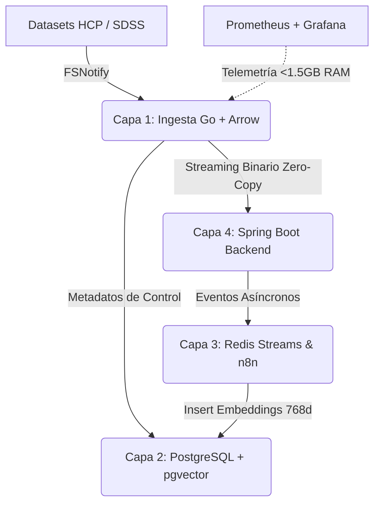

# 🌌 Armando González Yánez
### Data Infrastructure Engineer | SRE & AI Backend Specialist

Especialista en el diseño de arquitecturas distribuidas, fiabilidad de sistemas (SRE) y optimización extrema de recursos de hardware bajo restricciones operativas rígidas (FinOps <1.5 GB RAM global). Orientado a la ingeniería de requisitos basada en evidencia, el prototipado rápido asistido por IA (AI-Augmented Engineering) y la seguridad perimetral Zero-Trust en la inyección de secretos.

📍 CABA, Argentina | ✉️ armando13.133@gmail.com | 💼 [LinkedIn](https://linkedin.com)

---

## 🛠️ Matriz de Stack Tecnológico

- **Languages & Core Backend:** Go (Golang), Java (Spring Boot 3.3), Python, JavaScript/TypeScript
- **Data & Vectorial Infrastructure:** PostgreSQL 16 + pgvector (Índices HNSW 768d), Apache Arrow (Streaming Binario), Redis Streams
- **Operations, SRE & DevSecOps:** Docker & Docker Compose, Linux/Ubuntu CLI, Prometheus, Grafana, Bitwarden Secrets Manager (bws), Trivy
- **Integration Tools:** n8n, Gemini CLI (@google/genai con aislamiento `--code-execution`)

---

## 🚀 Proyectos Destacados (R&D / Homelab)

### 1) 🌌 JARVIS-COSMIC-BRAIN — Framework Híbrido de Ingesta Binaria e Infraestructura de IA
*Framework políglota diseñado para la evaluación morfológica cruzada del Conectoma Humano y la Red Cósmica bajo restricciones FinOps extremas.*
- **Ingesta Lineal (Go):** Demonio de red perimetral que mitiga el cuello de botella I/O mediante `fsnotify` y estructuración de flujos binarios cero-copia (Zero-Copy) con Apache Arrow.
- **Control Computacional (Java):** Backend asíncrono en Spring Boot que acota la saturación de memoria mediante un `ThreadPoolTaskExecutor` optimizado y respuestas reactivas desvinculadas.
- **Persistencia Semántica:** Base de datos PostgreSQL restringida por cgroups a 250MB de RAM, implementando embeddings de 768 dimensiones (text-embedding-004) sobre estructuras de grafos HNSW.
- **Hardening In-Memory:** Inyección dinámica de credenciales en tiempo de ejecución extrayendo secretos cifrados vía Bitwarden CLI (`bws`) directamente sobre sistemas de archivos volátiles en RAM nativa (`/run/jarvis-secrets/`).
- **Métrica Registrada:** Consumo global estable en reposo de ~1.1 GB de RAM medido y alertado mediante telemetría nativa con Prometheus y Grafana.

### 2) 🗺️ my-reactitinerary — Full Stack MERN Architecture
*Aplicación web cliente-servidor con un enfoque estricto en la separación de responsabilidades y organización de componentes.*
- Implementación de arquitectura desacoplada (Routes -> Controllers -> Models -> Services) sobre Node.js y Express.
- Persistencia relacional no estructurada utilizando colecciones distribuidas en MongoDB.

### 3) 🏛️ United-States-Congress — JavaScript & Data Processing
- Procesamiento y manipulación analítica de grandes volúmenes de datos legislativos en JavaScript de vanila.
- Modelado frontend de métricas complejas de asistencia, lealtad y consistencia de votación parlamentaria.

---

## 🧠 Fortalezas y Metodologías de Ingeniería
- **Análisis de Requisitos y Trade-Offs:** Capacidad comprobada para evaluar, debatir sistemáticamente e implementar arquitecturas políglotas basadas en la eficiencia operativa y restricciones reales de presupuesto de hardware.
- **Monitoreo Basado en SLOs:** Enfoque nativo en la observabilidad proactiva (Métricas, Logs y Trazas) orientado a mitigar el tiempo de resolución de incidentes (MTTR) y resguardar presupuestos de error operativos.
- **Principios:** Rigor técnico, gobernanza de datos soberanos, transparencia criptográfica y responsabilidad en infraestructura crítica.
